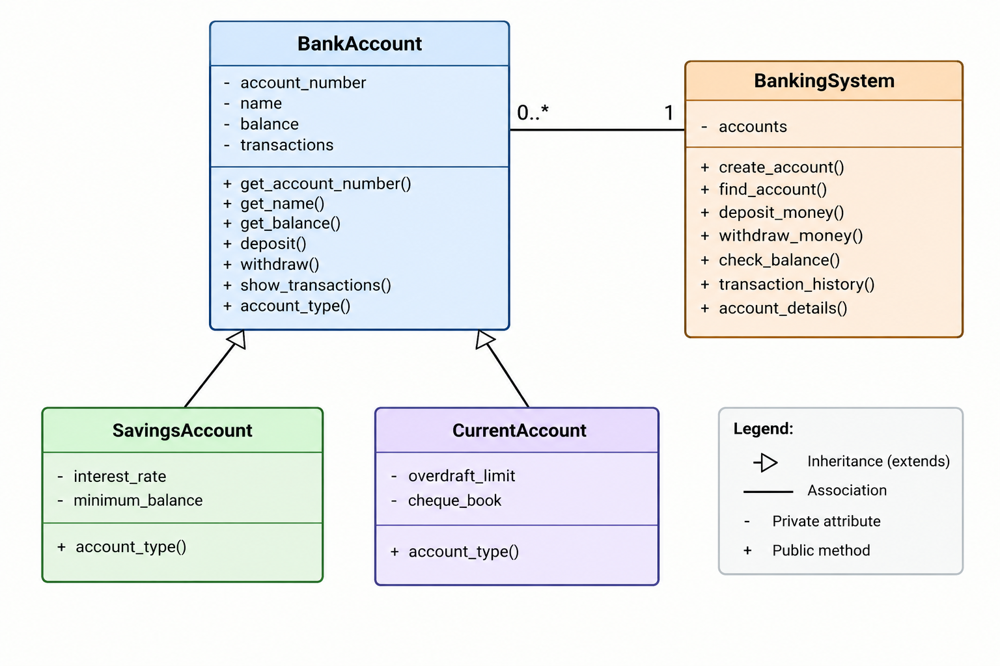

## Class Diagram



## Python Banking System

## Project Description

The Python Banking System is a simple console-based banking
application developed using Python and Object-Oriented Programming.

The system allows users to create a bank account, deposit money,
withdraw money, check balance, and view transaction history.

## Features

- Create Account
- Deposit Money
- Withdraw Money
- Check Balance
- Transaction History
- Account Details
- Savings Account
- Current Account

## OOP Concepts Used

### 1. Classes and Objects

Classes are used to create the structure of bank accounts.
Objects represent individual bank accounts.

### 2. Constructor

The `__init__()` method is used to initialize account details.

### 3. Encapsulation

Private variables are used to protect account information such as
balance, account number, and transaction history.

### 4. Inheritance

SavingsAccount and CurrentAccount inherit properties and methods
from the BankAccount class.

### 5. Polymorphism

The `account_type()` method is implemented differently in
SavingsAccount and CurrentAccount.

### 6. Abstraction

The BankAccount class is an abstract class and defines the
common structure for bank accounts.

## Technologies Used

- Python
- Object-Oriented Programming

## How to Run

1. Install Python.
2. Open the project in VS Code.
3. Open the terminal.
4. Run the following command:

```bash
python main.py